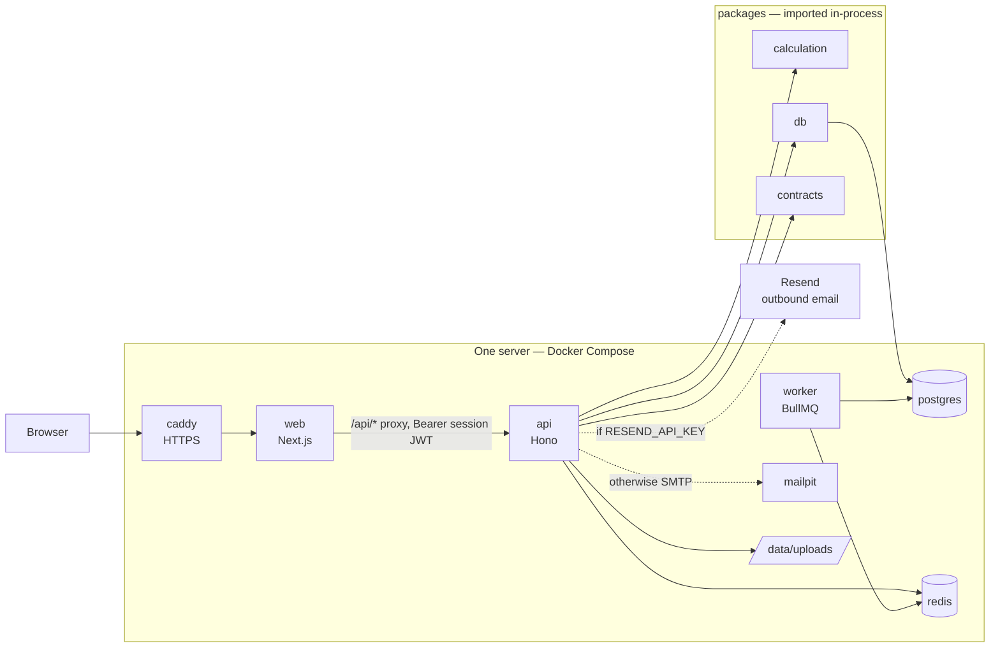

# PREVIO — Architecture (current & future)

How the monorepo is organized today and how it could evolve toward separately deployable services and Changesets.

## Principles

| Principle | Rationale |
|-----------|-----------|
| **Libraries first** | Domain logic lives in `packages/`; promote to `apps/<service>` only when deploy/scaling/team boundaries require it |
| **One gateway** | `apps/api` is the only service that authenticates users and decides what they may do (session JWT, RBAC + permissions, tenant context); anything else would sit behind it on the internal network |
| **Shared contracts** | `@schuco/contracts` holds Zod schemas, the permission map and the OpenAPI document so the web app and API don't drift |
| **The database enforces tenancy** | Postgres Row-Level Security does tenant isolation and share visibility; application code never relies on filtering alone ([ADR 0006](./adr/0006-rls-request-scoped-transaction.md)) |
| **Handbook in the app** | Public testing handbook at `/help` in `apps/web` (EN/IT/DE, same language cookie as the app). Repo `docs/` stays the place for ADRs and internal notes |

---

## Current layout

```
previo-schuco/
├── apps/
│   ├── web/                 # Next.js 15 (UI + server-side proxy to the API)
│   └── api/                 # Hono API; same image also runs the BullMQ worker
├── packages/
│   ├── calculation/         # Pure quote pricing (imported by the API)
│   ├── contracts/           # Zod schemas, permission map, OpenAPI spec
│   ├── db/                  # Drizzle schema, migrations, queries, RLS policies, seed
│   ├── env/                 # Per-target env resolution for local dev (ADR 0005)
│   └── queue/               # BullMQ job/worker helpers (ADR 0009)
├── docs/                    # Project context, deployment, architecture, ADRs
├── .github/workflows/       # CI (build + test + docker builds) and deploy (SSH)
├── docker-compose.yml       # The whole stack; `selfhost` profile adds web + caddy
├── Caddyfile                # HTTPS reverse proxy config
└── infra/terraform/         # LEGACY — retired AWS setup, unused (ADR 0013)
```



Requests flow `browser → caddy → web → api → postgres`. The browser never calls the API directly: every `/api/*` route in `apps/web` is a server-side proxy that attaches the session as a bearer token, so `api`, `postgres` and `redis` need no public exposure.

Locally the same stack runs with `docker compose up -d` (everything except `web`/`caddy`), and `pnpm dev` runs the web app on the host. See [deployment.md](./deployment.md).

---

## Possible future layout

Only if scale or team boundaries ever require it; nothing below exists yet.

```
previo-schuco/
├── apps/
│   ├── web/
│   ├── api/                      # still the only authenticated entry point
│   ├── calculation-service/      # HTTP quote engine, if recalculation outgrows the API
│   └── files-service/            # PDF render, import/export, storage abstraction
├── packages/
│   ├── calculation/  db/  contracts/
│   └── files/                    # storage + PDF helpers
└── .changeset/
```

Each extra service would be one more Compose service behind the same network (or a second host), reached by `apps/api` over internal HTTP — never directly from the browser.

## When to split a service

| Stay as `packages/*` (in-process) | Promote to `apps/*-service` (HTTP) |
|-----------------------------------|-------------------------------------|
| Fast, synchronous calls | Heavy/batch compute (quote recalc at scale) |
| Same release cadence as API | Independent scaling or SLA |
| Single team owns it | Separate team or tech stack |
| Today | Only when a real bottleneck appears |

### calculation-service (optional)

- `packages/calculation` stays the pure pricing functions
- `apps/calculation-service` would be a thin Hono wrapper (`POST /calculate`, `POST /validate`)
- `apps/api` calls it over the internal network; the web app never does

### files-service (optional)

- Today files are written to local disk (`apps/api/src/lib/local-storage.ts`, mounted at `./data/uploads`) and PDFs are rendered in the API (`apps/api/src/lib/quote-pdf.ts`)
- A separate service, or an object-storage backend behind the same storage interface, would only be worthwhile with multiple servers or large files

---

## Changesets (planned)

[Changesets](https://github.com/changesets/changesets) would coordinate **version bumps and changelogs** for `packages/*`.

| Scope | Versioned with Changesets? | Deploy |
|-------|---------------------------|--------|
| `@schuco/calculation`, `@schuco/db`, `@schuco/contracts` | Yes | Via the apps that depend on them |
| `apps/web`, `apps/api` | No (deploy on merge) | CI → SSH deploy of the Compose stack |

Workflow (future): run `pnpm changeset` when changing a package; on merge, a GitHub Action opens a "Version packages" PR; app deploys continue to run on `main` as today. Internal packages stay `private: true` — the goal is changelog discipline, not npm publishing.

## Handbook and reference

| Content | Location |
|---------|----------|
| Testing handbook (features, URLs, demo logins) | `apps/web` at `/help` (`apps/web/content/help/{en,it,de}`). Public, no login. Language follows the app cookie |
| API reference | `@schuco/contracts` OpenAPI + Swagger UI at `/docs` on the API (Caddy sends `/docs` to `api`, so the handbook cannot use that path) |
| Deployment runbooks | [`deployment.md`](./deployment.md) |
| ADRs, internal architecture | Repo [`docs/`](.) |

---

## Communication between services

1. **Sync, in-process (now):** `import from '@schuco/calculation'`, `@schuco/db`, `@schuco/contracts`
2. **Async (now):** BullMQ on Redis for background jobs, consumed by the `worker` service — [ADR 0009](./adr/0009-bullmq-background-jobs.md)
3. **HTTP between services (only if split):** REST + `@schuco/contracts` types
4. **Auth:** the session JWT is validated only in `apps/api`; any future service stays on the internal network

---

## Implementation checklist (future work)

- [ ] Add `@changesets/cli` + `.changeset/config.json`
- [x] Testing handbook at `/help` in `apps/web`
- [x] `packages/contracts` with quote/product/permission schemas
- [x] OpenAPI spec in `@schuco/contracts` (Swagger UI at `/docs`)
- [x] Background jobs on BullMQ (`worker` service)
- [ ] Extract `apps/calculation-service` (only if needed)
- [ ] Extract `apps/files-service` (only if needed)
- [ ] Remove the retired `infra/terraform/` directory and the AWS-only scripts

See also: [technical-overview.md](./technical-overview.md), [project-context.md](./project-context.md), [deployment.md](./deployment.md), [infra-status.md](./infra-status.md).
