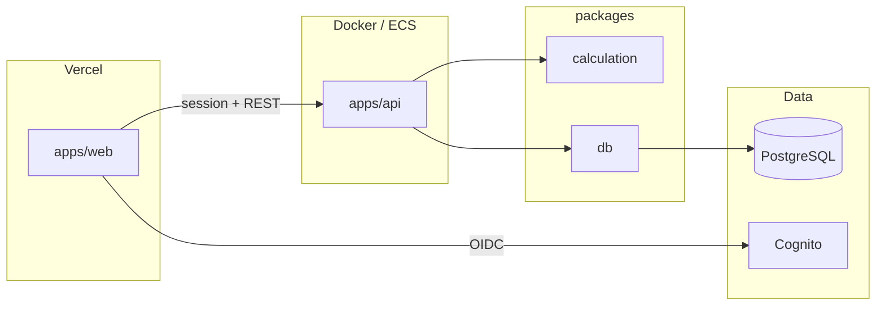
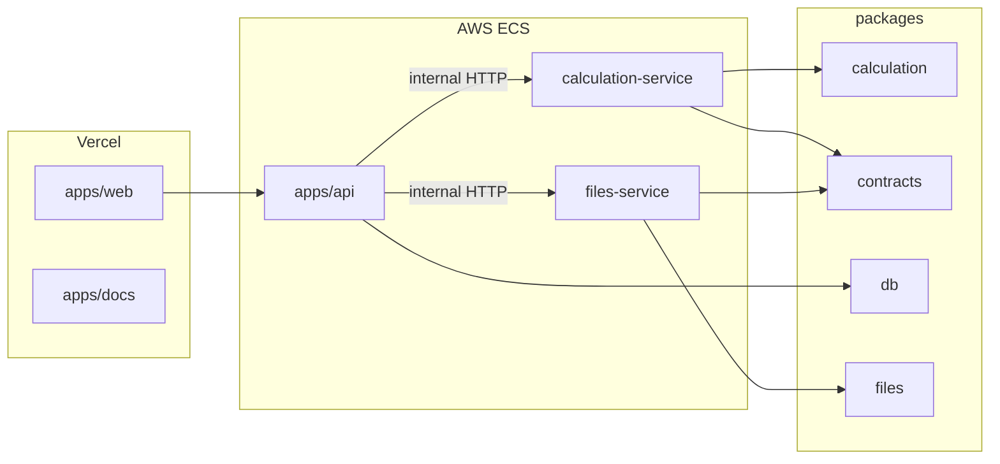

# PREVIO — Architecture (current & future)

How the monorepo is organized today and how it evolves toward separate deployable services, Changesets, and a Docusaurus docs site.

## Principles

| Principle | Rationale |
|-----------|-----------|
| **Libraries first** | Domain logic lives in `packages/`; promote to `apps/<service>` only when deploy/scaling/team boundaries require it |
| **One auth gateway** | `apps/api` remains the BFF — Cognito, RBAC, tenant context; other services are internal |
| **Shared contracts** | `@schuco/contracts` holds Zod schemas and the OpenAPI document so services don’t drift |
| **Independent docs** | User-facing docs in Docusaurus (`apps/docs`); repo `docs/` for ADRs and internal notes |

---

## Current layout (Phase 1)

```
previo-schuco/
├── apps/
│   ├── web/                 # Next.js → Vercel
│   └── api/                 # Hono BFF → ECS (dev) / Docker (local)
├── packages/
│   ├── calculation/         # Pure quote pricing (imported by API)
│   ├── contracts/           # Shared Zod schemas + OpenAPI spec
│   └── db/                  # Drizzle schema, migrations, RBAC queries
├── docs/                    # Markdown (project context, deployment, architecture)
├── infra/terraform/         # AWS dev (VPC, RDS, Cognito, ECS, S3)
└── .github/workflows/       # CI, API deploy, Terraform plan
```



---

## Target layout (Phase 2–5)

```
previo-schuco/
├── apps/
│   ├── web/                      # Next.js → Vercel
│   ├── api/                      # Core BFF: auth, RBAC, orchestration → ECS
│   ├── docs/                     # Docusaurus → Vercel (previo-schuco-docs)
│   ├── calculation-service/      # Phase 3+ — HTTP quote engine → ECS
│   └── files-service/            # Phase 4+ — S3, PDF, import/export → ECS
├── packages/
│   ├── calculation/              # Pure pricing logic (no HTTP)
│   ├── db/                       # Schema + queries
│   ├── contracts/                # Shared Zod types + API schemas
│   ├── files/                    # S3/PDF abstractions (Phase 4)
│   └── config-*/                 # Shared eslint/tsconfig (optional)
├── .changeset/                   # Changesets config
└── docs/                         # ADRs, links to apps/docs
```



---

## When to split a service

| Stay as `packages/*` (in-process) | Promote to `apps/*-service` (HTTP) |
|-----------------------------------|-------------------------------------|
| Fast, synchronous calls | Heavy/batch compute (quote recalc at scale) |
| Same release cadence as API | Independent scaling or SLA |
| Single team owns it | Separate team or tech stack |
| Phase 1–2 | Phase 3+ (calculation), Phase 4+ (files) |

### Phase 3 — calculation-service (optional)

- `packages/calculation` — unchanged pure functions
- `apps/calculation-service` — thin Hono: `POST /calculate`, `POST /validate`
- `apps/api` calls via internal ALB; web never calls calculation-service directly

### Phase 4 — files-service

- `packages/files` — S3 client, PDF templates, presigned URL helpers
- `apps/files-service` — upload/download, PDF render, Excel import/export
- IAM: files-service task role gets S3 access; API does not need bucket credentials

---

## Changesets (planned)

[Changesets](https://github.com/changesets/changesets) coordinates **version bumps and changelogs** for `packages/*`.

| Scope | Versioned with Changesets? | Deploy |
|-------|---------------------------|--------|
| `@schuco/calculation`, `@schuco/db`, `@schuco/contracts` | Yes | Via apps that depend on them |
| `apps/web`, `apps/api`, services | No (deploy on merge) | CI → Vercel / ECR+ECS |

**Workflow (future):**

1. Developer runs `pnpm changeset` when changing a package
2. Merge PR → GitHub Action opens “Version packages” PR or auto-bumps
3. App deploy workflows run on `main` as today

**Root scripts (to add):**

```json
"changeset": "changeset",
"version-packages": "changeset version",
"release": "pnpm build && changeset publish"
```

Internal packages stay `private: true`; Changesets is for changelog discipline and semver alignment, not npm publish (unless needed later).

---

## Docusaurus (planned)

| Content | Location |
|---------|----------|
| Product/domain docs, user guides | `apps/docs/docs/` |
| API reference (OpenAPI → plugin) | `@schuco/contracts` + Swagger UI at `/docs` |
| Deployment runbooks | Port from `docs/deployment.md` |
| ADRs, internal architecture | Repo `docs/` or `apps/docs/docs/internal/` |

**Deploy:** separate Vercel project `previo-schuco-docs` (recommended) or subdomain `docs.<domain>`.

**Turbo:**

```json
"docs#build": { "outputs": ["build/**"] }
```

Until `apps/docs` exists, canonical docs remain in repo [`docs/`](.).

---

## Terraform / Docker per service

Each new ECS app gets:

| Artifact | Pattern |
|----------|---------|
| Dockerfile | `apps/<service>/Dockerfile` or shared base |
| ECR repo | `previo-schuco-<env>-<service>` |
| ECS service | Reuse `infra/terraform/modules/ecs` module |
| CI | Extend `deploy-api-dev.yml` or add per-service workflow |

---

## Communication between services (when split)

1. **Sync (now):** `import from '@schuco/calculation'`
2. **Async (Phase 5+):** SQS for reports, notifications, bulk import
3. **HTTP (Phase 3–4):** REST + `@schuco/contracts` request/response types
4. **Auth:** service-to-service via internal network; user JWT validated only at `apps/api`

---

## Implementation checklist (future PRs)

- [ ] Add `@changesets/cli` + `.changeset/config.json`
- [ ] Scaffold `apps/docs` (Docusaurus classic)
- [x] Add `packages/contracts` with quote/product Zod schemas
- [ ] Extract `apps/calculation-service` (Phase 3, if needed)
- [ ] Extract `apps/files-service` (Phase 4)
- [x] OpenAPI spec in `@schuco/contracts` (Swagger UI at `/docs`; Docusaurus plugin later)

See also: [technical-overview.md](./technical-overview.md), [project-context.md](./project-context.md), [deployment.md](./deployment.md).
