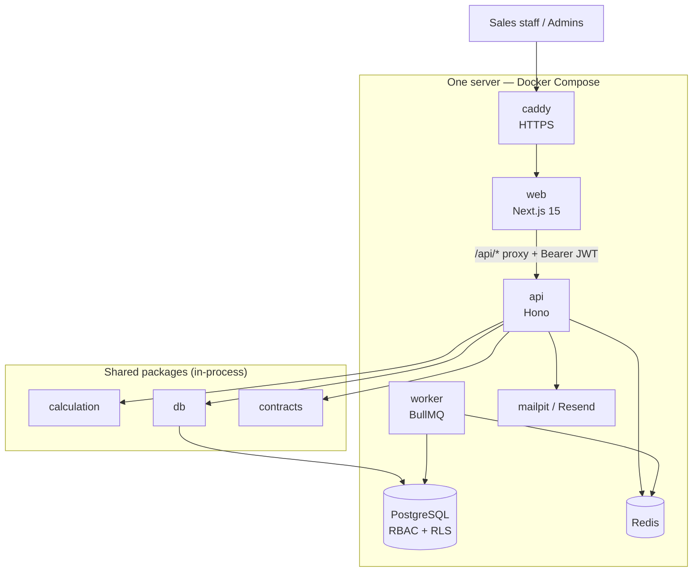
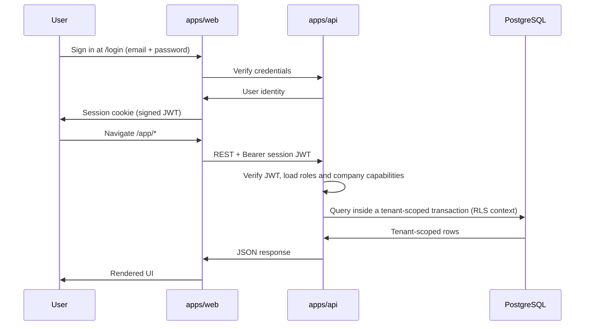
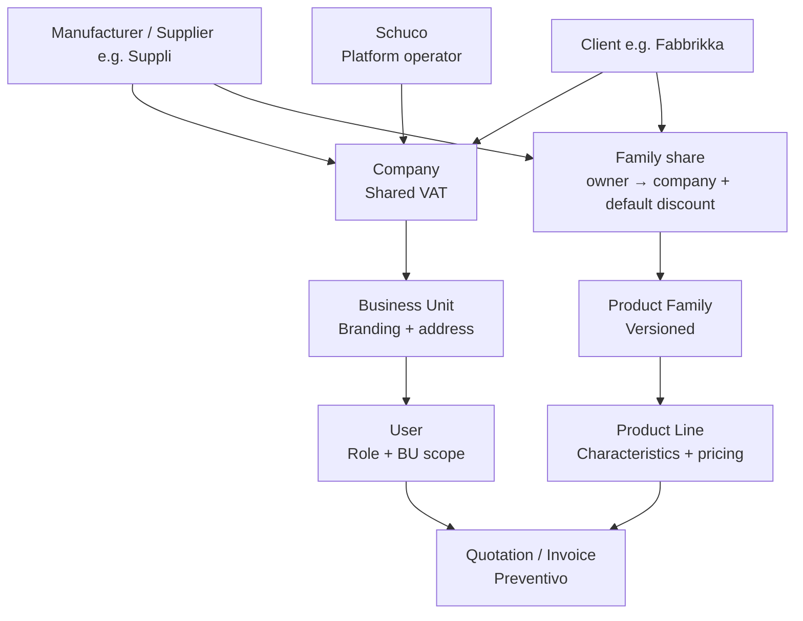
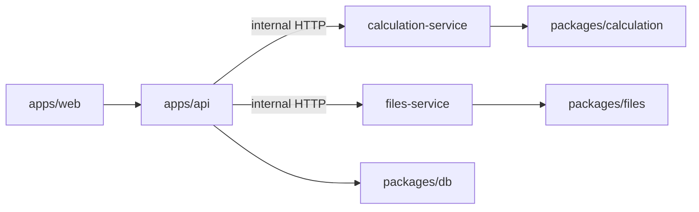

# PREVIO — Technical Overview

Visual guide to how the platform is built, who uses it, and how data flows. Intended for onboarding stakeholders, partners, and new developers.

For deeper detail see [project-context.md](./project-context.md) (domain & roadmap) and [architecture.md](./architecture.md) (monorepo evolution & future services).

---

## What PREVIO does

PREVIO is a B2B platform where **manufacturers** publish versioned **product families** (with product lines, characteristics and pricing matrices), **suppliers** build **quotations** (preventivi) from the families shared with them, and **clients** can browse what is shared with them. **Schuco** operates the platform.

| Actor | Role in the platform |
|-------|----------------------|
| **Schuco** | Platform operator (`super-admin` users, `platform` capability) |
| **Manufacturer** (e.g. Suppli) | Owns and edits a catalog of product families; shares published families with other companies, each with a default discount |
| **Supplier** (e.g. Suppli) | Creates quotes from its own families or from families shared with it; may share a received family onward |
| **Client** (e.g. Fabbrikka, Technometal) | Browses the families shared with it |

A company's abilities are independent **capabilities** (manufacturer, supplier, client, platform) — one company can hold several, for example Suppli is both manufacturer and supplier.

---

## System architecture



### Layer summary

| Layer | Components | Purpose |
|-------|-----------|---------|
| **Client** | Browser | Users interact with the Next.js app |
| **Edge** | Caddy | Automatic HTTPS, reverse proxy to `web` |
| **Application** | `apps/web`, `apps/api`, `worker` | UI + server-side proxy; Hono API orchestrates business logic; worker runs background jobs |
| **Packages** | `calculation`, `db`, `contracts` | Shared libraries imported in-process |
| **Data** | PostgreSQL, Redis, local disk | Tenant data + authorization (PostgreSQL + RLS); job queue; uploads |
| **Delivery** | GitHub Actions, Docker Compose | CI builds and tests, then deploys to the server over SSH — see [deployment.md](./deployment.md) |

### Request flow



---

## Domain model



### Organization hierarchy

```
Company (shared VAT)
  └── Business unit(s) — unique address, logo, branding
        └── Users (scoped to BUs, editing rights on a subset)
```

### Product hierarchy

```
Product family (versioned, owned by a manufacturer)
  └── Product line
        ├── Pricing matrix / formula
        └── Characteristics (colour, glazing, …) and their sub-characteristics
```

### Sharing and pricing rules

- A family is visible to another company only when it is **published** and **shared** with it (or with someone who shared it onward). Unpublishing, or revoking an upstream share, hides it immediately.
- Each share carries a **default discount** for the receiver's quote positions. It is only a default: the receiver can change it on each position. `0%` means "no specific discount" and the line's own catalog discount applies.
- Material pricing differences still call for a **new product family** version.
- Quotes belong to the supplier that issues them and are priced from its own families or families shared with it. Any position's price, and any characteristic's price, can be switched from automatic to a typed-in value. A quote is a matrix of versions and alternatives (`V1A2`): a new version copies only the selected cell, and one variant can be marked final for the dashboard ([ADR 0016](./adr/0016-quote-variants.md)).

---

## Security model

Authentication, authorization and tenancy are separate concerns:

| Concern | Technology | Question answered |
|---------|-----------|-------------------|
| **Authentication** | Own email + password, bcrypt-hashed; signed session JWT | Who are you? |
| **Authorization** | Role × permission matrix, filtered by company capabilities | What may you do? |
| **Tenancy** | PostgreSQL Row-Level Security | Which rows may you see and write? |
| **Gateway** | `apps/api` | Verifies the JWT, resolves tenant context, enforces permissions |

### Auth flow

1. **Login** — email + password at `/login` (a password-less demo-user shortcut exists for seeded users when `ALLOW_DEV_LOGIN` is on)
2. **Session** — `apps/web` signs a session JWT (`AUTH_SECRET`) into a cookie; middleware protects `/app/*` and `/admin/*`
3. **API call** — web's server-side proxy sends the JWT as a bearer token on every request
4. **Verify** — `apps/api` verifies the signature and expiry, loads the user's roles and company
5. **Permissions** — effective permissions = (permissions of the user's roles, from the editable matrix) ∩ (what the company's capabilities unlock); super-admin bypasses the capability filter
6. **RLS** — queries run in a tenant-scoped transaction so Postgres itself limits the rows; `GET /api/me` returns the profile and effective permissions

Users are **invited** (no self sign-up): an emailed one-time link opens `/set-password`. A company-admin's invitation waits for super-admin approval.

### Roles

Four built-in roles; a super-admin can add custom roles (global, no permissions until granted in Access Rights). A user may hold several roles.

| Role ID | Display name | Scope | Capabilities |
|---------|--------------|-------|--------------|
| `super-admin` | Super Admin | Cross-tenant | All companies, users, platform settings (PREVIO / Schuco operators) |
| `company-admin` | Company Admin | Company + assigned BUs | Company settings, user management, product visibility |
| `super-user` | Super User (Sales Manager) | Assigned business units | Create/edit offers; view team offers within scoped BUs |
| `user` | User (Sales Associate) | Assigned business units | Create/edit own offers only |

Users may belong to **multiple** business units but have **editing rights** on a subset.

What each role may do is not hard-coded: the **Access Rights** matrix (super-admin) maps roles to permissions (`catalog.view`, `catalog.edit`, `catalog.share`, `quote.view`, `quote.edit`, `users.manage`). Company capabilities then decide which of those a company can use at all — for example only a manufacturer can edit a catalog and only a supplier can create quotes.

---

## Monorepo layout

```
previo-schuco/
├── apps/
│   ├── web/          Next.js frontend (+ server-side proxy to the API)
│   └── api/          Hono API (+ BullMQ worker entrypoint)
├── packages/
│   ├── calculation/  Pure quote pricing (no HTTP)
│   ├── contracts/    Zod schemas, permission map, OpenAPI spec
│   ├── db/           Drizzle schema, migrations, queries, RLS policies, seed
│   ├── env/          Env resolution for local dev
│   └── queue/        BullMQ helpers
├── docs/             Project documentation (this file)
├── docker-compose.yml, Caddyfile   The whole deployable stack
└── infra/terraform/  Legacy, unused (retired AWS setup)
```

### Key routes & endpoints

| Path | Description |
|------|-------------|
| `/` | Public home |
| `/help` | Public testing handbook (features, URLs, demo logins). No language prefix |
| `/login` | Email + password (or the demo-user shortcut) |
| `/app/*` | Authenticated app (dashboard, invoice editor, settings) |
| `/admin/*` | Super-admin portal |
| `GET /api/me` | Current user profile |
| `GET /docs` | Swagger UI (API) |

### Local development

```bash
docker compose up -d   # Postgres, Redis, Mailpit, API (:3001) and worker
pnpm dev               # Web on :3000
```

Demo users are defined in `packages/db/src/demo-users.ts` and seeded via `packages/db/src/seed.ts`.

---

## Roadmap phases

| Phase | Focus | Timeline |
|-------|-------|----------|
| **1 — Foundations** | Hosting, auth/RBAC, Next.js + API scaffold | W1–W3 |
| **2 — Core data** | Product lines, profiles, price-list UI | W4–W7 |
| **3 — Quote engine** | Calculator, workflow, quote builder UI | W8–W12 |
| **4 — Documents & I/O** | PDF, import/export, print templates | W13–W15 |
| **5 — Platform services** | Reporting, notifications, admin portal | W16–W18 |
| **6–8** | Integration, UAT, hardening | W19–W24 |

### Future architecture (Phase 3–4)

If independent scaling is ever needed, heavy workloads could split into dedicated services on the internal network while `apps/api` remains the auth gateway (nothing below exists yet):



See [architecture.md](./architecture.md) for the full split criteria and Changesets plan.

---

## One-liner

> PREVIO is a multi-tenant B2B quoting platform: manufacturers publish versioned product families and share them (with default discounts), suppliers build quotations from them, and Schuco operates the platform with role- and capability-based access across companies and business units.
