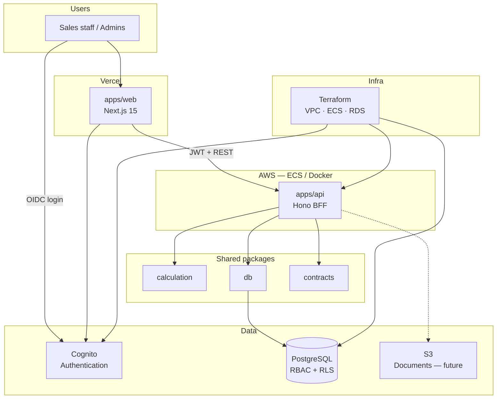
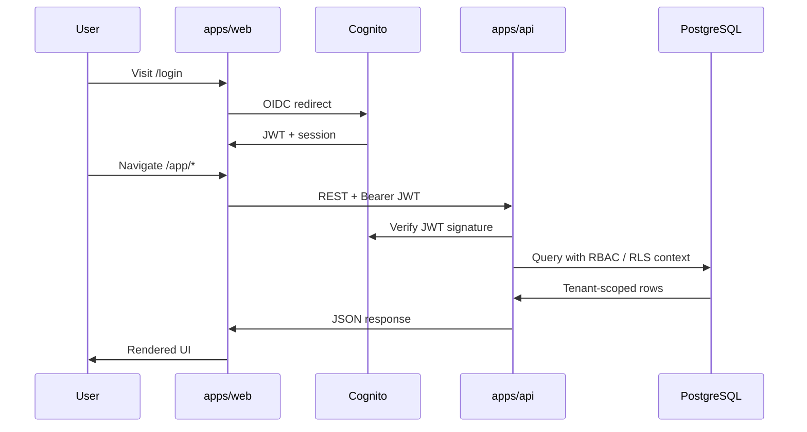
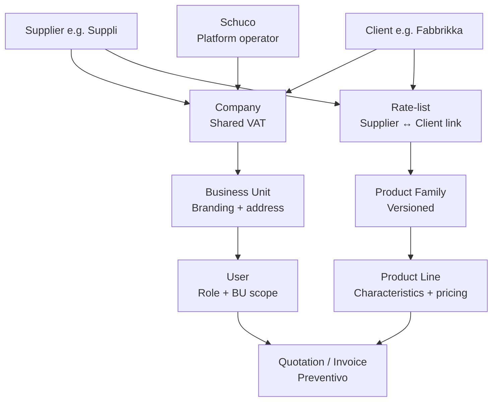
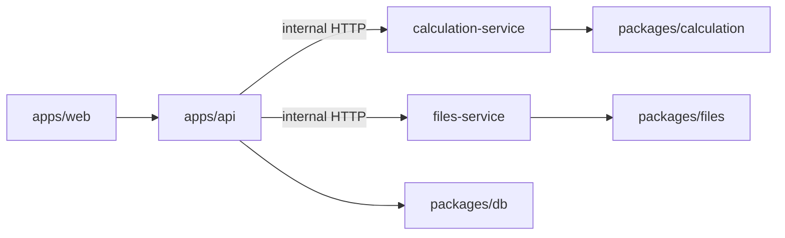

# PREVIO — Technical Overview

Visual guide to how the platform is built, who uses it, and how data flows. Intended for onboarding stakeholders, partners, and new developers.

For deeper detail see [project-context.md](./project-context.md) (domain & roadmap) and [architecture.md](./architecture.md) (monorepo evolution & future services).

---

## What PREVIO does

PREVIO is a B2B platform where **suppliers** publish versioned product **rate-lists** and **clients** build **quotations** (preventivi) and invoices from those lists. **Schuco** operates the platform as both operator and supplier.

| Actor | Role in the platform |
|-------|----------------------|
| **Schuco** | Platform operator (`super-admin`) and a supplier whose product families are available to all clients |
| **Supplier** (e.g. Suppli) | Provides product lines with client-specific pricing via discounts |
| **Client** (e.g. Fabbrikka, Technometa) | Creates quotations from rate-lists provided by linked suppliers |

---

## System architecture (Phase 1)



### Layer summary

| Layer | Components | Purpose |
|-------|-----------|---------|
| **Client** | Browser | Users interact with the Next.js app |
| **Application** | `apps/web`, `apps/api` | UI on Vercel; Hono BFF on ECS/Docker orchestrates business logic |
| **Packages** | `calculation`, `db`, `contracts` | Shared libraries imported in-process by the API |
| **Data** | Cognito, PostgreSQL, S3 | Authentication (Cognito); authorization + tenant data (PostgreSQL + RLS) |
| **Infrastructure** | Terraform | Provisions AWS dev environment (VPC, ECS, RDS, Cognito) |

### Request flow



---

## Domain model



### Organization hierarchy

```
Company (shared VAT)
  └── Business unit(s) — unique address, logo, branding
        └── Users (scoped to BUs, editing rights on a subset)
```

### Product hierarchy (Phase 2+)

```
Product family (versioned)
  └── Product line
        └── Sub-characteristics (color, glazing, etc.)
              └── Linked characteristics + installation hours
```

### Pricing rules

- Client-specific **discounts** apply on the **same rate-list** — not duplicate product families.
- Material pricing differences require a **new product family** version.
- Supplier–client links are many-to-many; each link can carry a client discount and installation hours.

---

## Security model

Authentication and authorization are deliberately split:

| Concern | Technology | Question answered |
|---------|-----------|-------------------|
| **Authentication** | AWS Cognito (OIDC) | Who are you? |
| **Authorization** | PostgreSQL RBAC + RLS | What can you see and edit? |
| **Gateway** | `apps/api` | Validates JWT, resolves tenant context |

### Auth flow (6 steps)

1. **Login** — User signs in via Cognito OIDC (or dev-login locally)
2. **Session** — Next.js stores session; middleware protects `/app/*` and `/admin/*` routes
3. **API call** — Web sends JWT to `apps/api` on each REST request
4. **Verify** — API validates Cognito JWT signature and expiry
5. **RBAC** — PostgreSQL resolves role + business-unit scope via RLS
6. **Response** — Data filtered to tenant; `GET /api/me` returns profile

### Four canonical roles

| Role ID | Display name | Scope | Capabilities |
|---------|--------------|-------|--------------|
| `super-admin` | Super Admin | Cross-tenant | All companies, users, platform settings (PREVIO / Schuco operators) |
| `company-admin` | Company Admin | Company + assigned BUs | Company settings, user management, product visibility |
| `super-user` | Super User (Sales Manager) | Assigned business units | Create/edit offers; view team offers within scoped BUs |
| `user` | User (Sales Associate) | Assigned business units | Create/edit own offers only |

Users may belong to **multiple** business units but have **editing rights** on a subset.

---

## Monorepo layout

```
previo-schuco/
├── apps/
│   ├── web/          Next.js frontend → Vercel
│   └── api/          Hono BFF → ECS / Docker
├── packages/
│   ├── calculation/  Pure quote pricing (no HTTP)
│   ├── db/           Drizzle schema, migrations, RBAC queries
│   └── contracts/    Shared Zod schemas + OpenAPI spec
├── infra/terraform/  AWS infrastructure
└── docs/             Project documentation (this file)
```

### Key routes & endpoints

| Path | Description |
|------|-------------|
| `/` | Public home |
| `/login` | Cognito or dev login |
| `/app/*` | Authenticated app (dashboard, invoice editor, settings) |
| `/admin/*` | Super-admin portal |
| `GET /api/me` | Current user profile |
| `GET /docs` | Swagger UI (API) |

### Local development

```bash
docker compose up -d   # Postgres + API on :3001
pnpm dev               # Web on :3000
```

Demo users are defined in `packages/db/src/demo-users.ts` and seeded via `packages/db/src/seed.ts`.

---

## Roadmap phases

| Phase | Focus | Timeline |
|-------|-------|----------|
| **1 — Foundations** | Infra, auth/RBAC, Next.js + API scaffold | W1–W3 |
| **2 — Core data** | Product lines, profiles, price-list UI | W4–W7 |
| **3 — Quote engine** | Calculator, workflow, quote builder UI | W8–W12 |
| **4 — Documents & I/O** | PDF, import/export, print templates | W13–W15 |
| **5 — Platform services** | Reporting, notifications, admin portal | W16–W18 |
| **6–8** | Integration, UAT, hardening | W19–W24 |

### Future architecture (Phase 3–4)

When independent scaling is needed, heavy workloads split into dedicated ECS services while `apps/api` remains the auth gateway:



See [architecture.md](./architecture.md) for the full split criteria and Changesets plan.

---

## One-liner

> PREVIO is a multi-tenant B2B quoting platform: suppliers publish versioned product rate-lists, clients build quotations from those lists, and Schuco operates the platform with role-based access across companies and business units.
